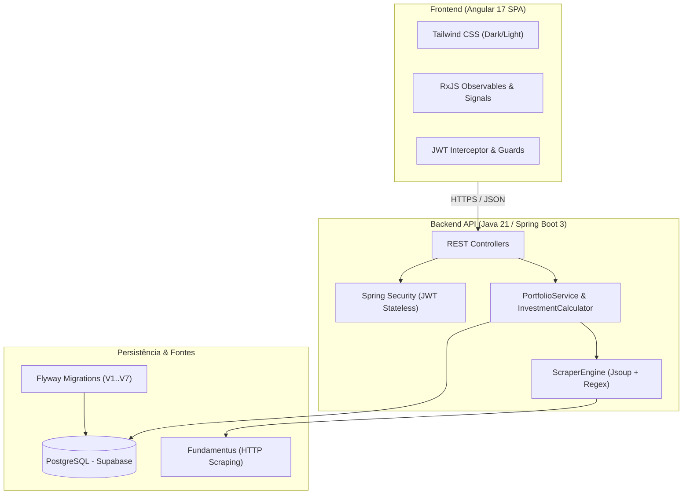
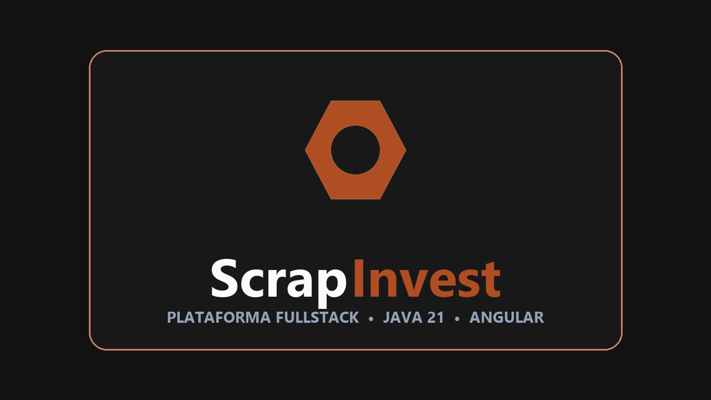

<div align="center">
  

  <p><strong>Inteligência Fundamentalista & Gestão de Carteira</strong></p>
  <p>Sistema fullstack para análise de ações, fundos imobiliários, simulação de renda fixa e consolidação de carteira em tempo real.</p>

  <p>
    <a href="https://scrapinvest-lemon.vercel.app">Aplicação ao Vivo</a> |
    <a href="https://scrapinvest-backend.onrender.com/api/stocks/PETR4">API Backend</a> |
    <a href="https://youtu.be/o_AyEzC66GQ">Vídeo de Demonstração</a>
  </p>
</div>

---

## Demonstração

<div align="center">
  
</div>

---

## Proposta

Investidores perdem tempo abrindo dezenas de abas, preenchendo planilhas manuais e usando calculadoras isoladas para gerenciar posições da B3. 

O ScrapInvest unifica esse fluxo extraindo dados fundamentalistas em tempo real, aplicando regras de negócio separadas para ações e fundos imobiliários, e recalculando preço médio e alocação patrimonial no backend.

---

## Funcionalidades

### 1. Comparador de Ativos
- Comparação lado a lado de múltiplos papéis com ordenação por qualquer coluna.
- Tratamento automático para empresas do setor financeiro e bancário que não reportam endividamento tradicional (dívida bruta, líquida ou margem EBITDA).

### 2. Análise de Papel e FIIs
- Motor de scraping com cache e fallback transparente.
- Regras dedicadas para Fundos Imobiliários:
  - Barra de composição proporcional de ativos (Imóveis para Renda, Ações Imobiliárias, CRI/CRA e Caixa).
  - Tabela física de imóveis (área m², aluguel/m², preço do m², cap rate e vacância física).
- Alternador de layout: Split View (moderno), Fundamentus Clássico (retrô tabular) e Abas.

### 3. Simulador de Renda Fixa
- Cálculo de juros compostos com aportes mensais e prazo configurável.
- Gráfico dinâmico comparando capital total aportado contra juros acumulados.
- Tabela de comparação de resgate líquido com Tesouro Direto, CDB, LCI/LCA e Poupança.

### 4. Carteira e Custódia
- Acesso rápido para testes via conta de demonstração com um clique, ou cadastro com JWT.
- Cálculo transacional no backend de preço médio ponderado, rentabilidade acumulada e patrimônio consolidado.
- Gráfico e barra de distribuição percentual entre Ações, FIIs e Renda Fixa.

---

## Arquitetura



---

## Identidade Visual & Branding

<div align="center">
  
</div>

### Paleta de Cores

| Cor | Hex | RGB | Uso |
| :--- | :--- | :--- | :--- |
| Laranja Ferrugem | `#AF4E22` | `175, 78, 34` | Cor primária, botões de ação e logo |
| Fundo Dark | `#121212` | `18, 18, 18` | Fundo principal da aplicação |
| Superfície Cards | `#181818` | `24, 24, 24` | Painéis elevados, cards e tabelas |
| Bordas | `#2E2E2E` | `46, 46, 46` | Linhas de divisão e contornos |
| Verde Esmeralda | `#10B981` | `16, 185, 129` | Indicadores de alta, lucro e Ações |
| Azul | `#60A5FA` | `96, 165, 250` | Fundos Imobiliários (FIIs) e imóveis |
| Âmbar | `#F59E0B` | `245, 158, 11` | Renda Fixa e títulos CRI/CRA |

### Tipografia
- Textos e Interface: **Inter** (Google Fonts).
- Tickers e Métricas Financeiras: **JetBrains Mono** (fonte monoespaçada tabular).

Arquivos vetoriais e logos em alta resolução com fundo transparente estão disponíveis no diretório `docs/branding/`:
- `docs/branding/scrapinvest-icon-1024.png` (ícone da porca hexagonal)
- `docs/branding/scrapinvest-logo-dark-theme.png` (logo horizontal para fundo escuro)
- `docs/branding/scrapinvest-logo-light-theme.png` (logo horizontal para fundo claro)
- `docs/branding/scrapinvest-thumbnail-card-1280x720.png` (card para capas e thumbnails)

---

## Execução Local

### Pré-requisitos
- JDK 21
- Node.js 18+ e npm
- PostgreSQL

### 1. Clonar o repositório
```bash
git clone https://github.com/CaioSantanaDEV/scrapinvest.git
cd scrapinvest
```

### 2. Configurar o banco de dados
Crie o banco no PostgreSQL:
```sql
CREATE DATABASE scrapinvest;
```

Defina as variáveis de ambiente ou altere `backend/src/main/resources/application.properties`:
```bash
export SPRING_DATASOURCE_URL=jdbc:postgresql://localhost:5432/scrapinvest
export SPRING_DATASOURCE_USERNAME=seu_usuario
export SPRING_DATASOURCE_PASSWORD=sua_senha
```

### 3. Iniciar o backend
```bash
cd backend
mvn clean spring-boot:run
```
A API roda em `http://localhost:8080`.

### 4. Iniciar o frontend
```bash
cd frontend
npm install
npm start
```
A aplicação roda em `http://localhost:4200`.

---

## Tecnologias

### Backend
- Java 21 LTS
- Spring Boot 3.4.3 (Web, Security, Data JPA, Validation)
- Jsoup 1.18.3
- PostgreSQL Driver & HikariCP
- Flyway Migrations
- JJWT 0.12.6

### Frontend
- Angular 17 (Standalone Components, Signals)
- Tailwind CSS 3.4
- Chart.js
- TypeScript 5.4 & RxJS 7.8

### Infraestrutura
- Docker
- Render (Hospedagem do backend via container)
- Vercel (Deploy contínuo do frontend)
- Supabase (PostgreSQL gerenciado)

<div align="center">
  <p>
    
    
    
    
    
    
    
    
  </p>
</div>

---

## Autor

Caio Santana
- LinkedIn: https://www.linkedin.com/in/caio-santana-6a0b12267/
- Aplicação ao vivo: https://scrapinvest-lemon.vercel.app

Licença MIT.
